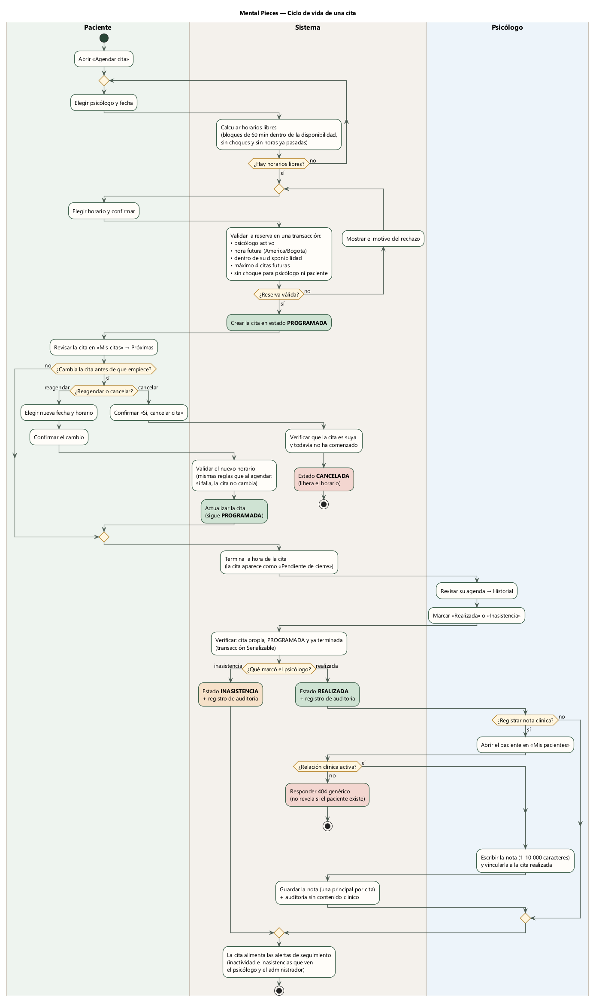

# Mental Pieces — Diagrama de actividades: ciclo de vida de una cita

Fuente: [`activity-diagram.puml`](activity-diagram.puml) (PlantUML) · Imagen: [`activity-diagram.png`](activity-diagram.png) / [`activity-diagram.svg`](activity-diagram.svg)

## Carriles

| Carril | Qué representa |
| --- | --- |
| Paciente | Acciones en `/appointments/new` y `/appointments`. |
| Sistema | Validaciones del frontend y de la API (`AppointmentsService`, `AppointmentLifecycleService`, `ClinicalService`). |
| Psicólogo | Acciones en `/psychologist/appointments` y `/psychologist/patients`. |

## Etapas

| Etapa | Qué ocurre | Dónde está la regla |
| --- | --- | --- |
| 1. Agendar | El sistema solo ofrece horarios libres de 60 min. Al confirmar valida psicólogo activo, hora futura en America/Bogota, disponibilidad, máximo 4 citas futuras y que no haya choques. Si falla, muestra el motivo y el paciente elige otro horario. | `AppointmentsService.getAvailableSlots`, `create` |
| 2. Antes de la cita | El paciente puede mantenerla, reagendarla (mismas reglas) o cancelarla con confirmación, siempre que no haya comenzado. | `AppointmentsService.reschedule`, `cancel` |
| 3. Cierre | Cuando la hora termina, la cita aparece como «Pendiente de cierre». El psicólogo la marca realizada o inasistencia; el sistema verifica que sea suya, PROGRAMADA y terminada, y registra auditoría. | `AppointmentLifecycleService.finish` |
| 4. Nota clínica (opcional) | Solo con relación clínica activa (si no, 404 genérico). Nota de 1–10 000 caracteres, vinculable solo a una cita REALIZADA, una principal por cita; auditoría sin contenido. | `ClinicalService.createNote`, `ClinicalAccessService` |
| Seguimiento | Las citas realizadas e inasistencias alimentan las alertas de inactividad. | `CareAlertsService` |

## Estados de la cita

`PROGRAMADA` (SCHEDULED) → `CANCELADA` (CANCELLED) · `REALIZADA` (COMPLETED) · `INASISTENCIA` (NO_SHOW).
Una cita programada cuya hora ya terminó se muestra como «Pendiente de cierre» hasta que el psicólogo la cierra; no se cierra sola.
