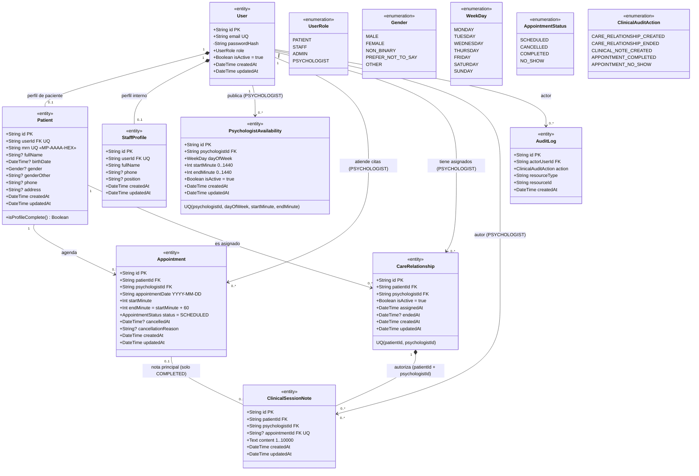
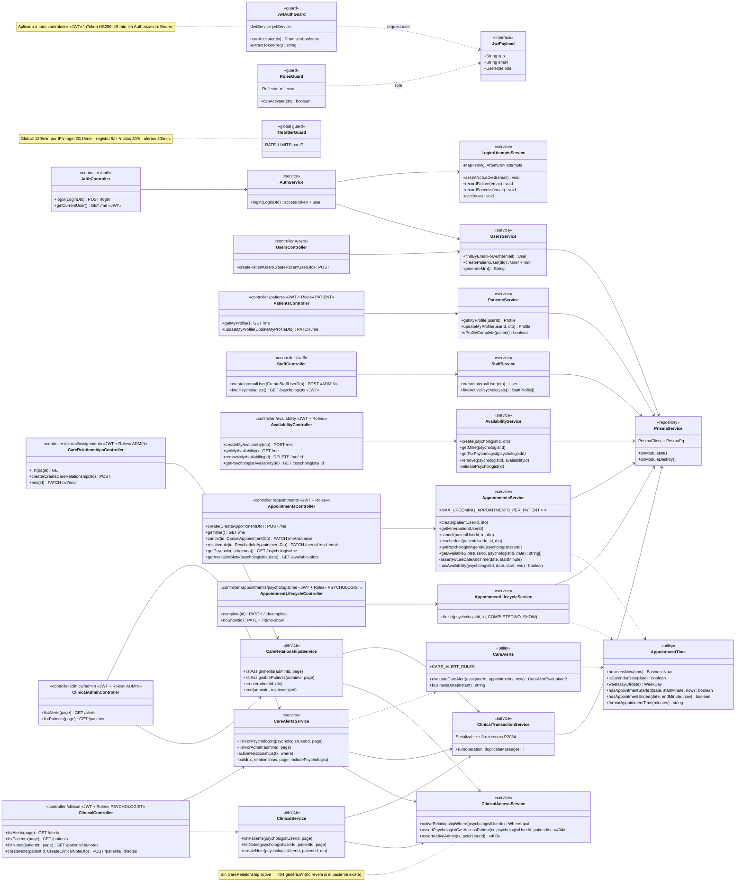

# Mental Pieces — Diagramas de clases

Generados a partir del código (`apps/api/prisma/schema.prisma` y `apps/api/src/`), 2026-10-18.

Convenciones:

- `PK` clave primaria, `FK` clave foránea, `UQ` única, `?` opcional (nullable).
- Multiplicidades en cada extremo: `1`, `0..1`, `0..*`.
- `*--` composición (el hijo no existe sin el padre) · `-->` asociación navegable · `..>` dependencia/uso.

---

## Diagrama 1 · Modelo de dominio

### Reglas de negocio del modelo

| Entidad | Regla |
| --- | --- |
| `User` | El `role` define el perfil: PATIENT → `Patient`; STAFF / PSYCHOLOGIST / ADMIN → `StaffProfile`. El registro público siempre crea PATIENT. `passwordHash` nunca sale del API. |
| `Appointment` | Duración 60 min, hora de negocio America/Bogota. SCHEDULED → COMPLETED \| NO_SHOW (psicólogo, cuando terminó); SCHEDULED → CANCELLED (paciente, antes de iniciar). Máx. 4 citas futuras por paciente. No requiere `CareRelationship`. |
| `CareRelationship` | Autoriza el acceso clínico (no el agendamiento). Solo ADMIN la crea o finaliza. Una pareja paciente–psicólogo es única, incluso finalizada. |
| `ClinicalSessionNote` | Requiere `CareRelationship` activa (FK compuesta `patientId + psychologistId`). Cada psicólogo ve solo sus notas. Vinculable a una cita COMPLETED como máximo una vez (`appointmentId` único). Sin edición ni borrado. |
| `AuditLog` | Solo metadatos, nunca contenido clínico. `resourceType + resourceId` es una referencia polimórfica a `CareRelationship`, `ClinicalSessionNote` o `Appointment`. |

---

## Diagrama 2 · Clases del backend (NestJS)

Flujo: **Controller → Service → PrismaService → PostgreSQL**. Los controladores marcados `«JWT + Roles»`
usan `JwtAuthGuard` y `RolesGuard`; la identidad sale siempre de `request.user.sub` (JWT), nunca del body.

### DTOs de entrada (validados por `ValidationPipe` con `whitelist` + `forbidNonWhitelisted`)

| DTO | Campos | Usado por |
| --- | --- | --- |
| `LoginDto` | email, password (8–72) | `AuthController.login` |
| `CreatePatientUserDto` | email, password (8–72) | `UsersController` |
| `CreateStaffUserDto` | email, password, fullName, role (STAFF \| PSYCHOLOGIST), phone?, position? | `StaffController` |
| `UpdateMyProfileDto` | fullName?, birthDate?, gender?, genderOther?, phone? | `PatientsController` |
| `CreateAvailabilityDto` | dayOfWeek, startTime, endTime (HH:mm) | `AvailabilityController` |
| `CreateAppointmentDto` | psychologistId (User.id), appointmentDate, startTime | `AppointmentsController.create` |
| `RescheduleAppointmentDto` | appointmentDate, startTime | `AppointmentsController.reschedule` |
| `CancelAppointmentDto` | reason? (≤300) | `AppointmentsController.cancel` |
| `FinishAppointmentDto` | — (vacío: rechaza cualquier campo) | `AppointmentLifecycleController` |
| `CreateCareRelationshipDto` | patientId, psychologistId (CUID) | `CareRelationshipsController.create` |
| `EndCareRelationshipDto` | — (vacío) | `CareRelationshipsController.end` |
| `CreateClinicalNoteDto` | content (1–10 000), appointmentId? | `ClinicalController.createNote` |
| `ClinicalPageDto` | page (1–10 000) | listados paginados clínicos |
