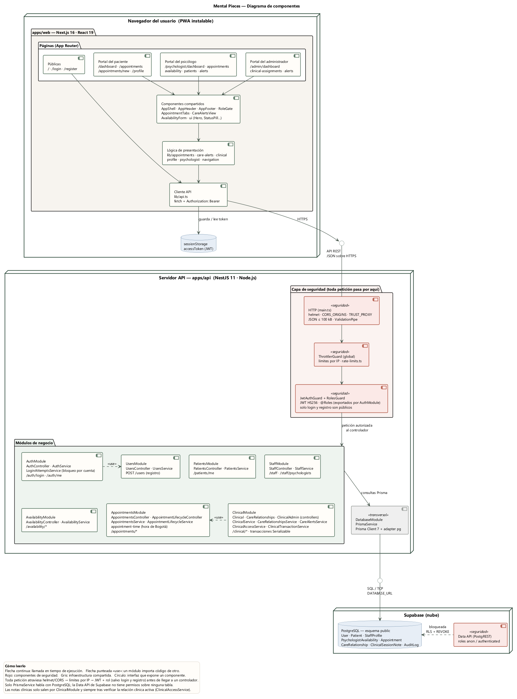

# Mental Pieces — Diagrama de componentes

Fuente: [`component-diagram.puml`](component-diagram.puml) (PlantUML) · Imagen: [`component-diagram.png`](component-diagram.png) / [`component-diagram.svg`](component-diagram.svg)

## Nodos

| Nodo | Tecnología | Responsabilidad |
| --- | --- | --- |
| Navegador del usuario | Next.js 16 · React 19 (PWA instalable) | Interfaz por rol; guarda el JWT en `sessionStorage`. |
| Servidor API | NestJS 11 · Node.js | Reglas de negocio, autenticación, autorización y límites de uso. |
| Supabase | PostgreSQL | Persistencia. Solo la API accede (vía `DATABASE_URL`); la Data API está bloqueada. |

## Componentes del frontend (`apps/web`)

| Componente | Archivos | Depende de |
| --- | --- | --- |
| Páginas públicas | `app/page.tsx`, `app/login`, `app/register` | Cliente API |
| Portal del paciente | `app/dashboard`, `app/appointments`, `app/profile` | Componentes compartidos |
| Portal del psicólogo | `app/psychologist/*` | Componentes compartidos |
| Portal del administrador | `app/admin/*` | Componentes compartidos |
| Componentes compartidos | `components/*` (AppShell, RoleGate, AppointmentTabs, CareAlertsView, AvailabilityForm, ui) | Lógica de presentación |
| Lógica de presentación | `lib/appointments`, `care-alerts`, `clinical`, `profile`, `psychologist`, `navigation` | Cliente API |
| Cliente API | `lib/api.ts` | API REST, `sessionStorage` |

## Componentes del backend (`apps/api`)

| Componente | Contenido | Interfaz expuesta | Depende de |
| --- | --- | --- | --- |
| HTTP (`main.ts`) | helmet, CORS por `CORS_ORIGINS`, `TRUST_PROXY`, JSON ≤ 100 kB, `ValidationPipe` (whitelist) | API REST | — |
| ThrottlerGuard | Guard global; límites en `security/rate-limits.ts` | — | — |
| JwtAuthGuard + RolesGuard | JWT HS256, `@Roles` | Exportados por AuthModule | JwtModule |
| AuthModule | AuthController, AuthService, LoginAttemptsService | `/auth/login`, `/auth/me` | UsersModule (UsersService) |
| UsersModule | UsersController, UsersService | `POST /users` | DatabaseModule |
| PatientsModule | PatientsController, PatientsService | `/patients/me` | DatabaseModule |
| StaffModule | StaffController, StaffService | `/staff`, `/staff/psychologists` | DatabaseModule |
| AvailabilityModule | AvailabilityController, AvailabilityService | `/availability/*` | DatabaseModule |
| AppointmentsModule | AppointmentsController, AppointmentLifecycleController, sus servicios, `appointment-time` | `/appointments/*` | DatabaseModule |
| ClinicalModule | ClinicalController, CareRelationshipsController, ClinicalAdminController; ClinicalService, CareRelationshipsService, CareAlertsService, ClinicalAccessService, ClinicalTransactionService | `/clinical/*` | DatabaseModule, `appointment-time` |
| DatabaseModule | PrismaService (Prisma Client 7 + `@prisma/adapter-pg`) | PrismaService | PostgreSQL |

## Reglas que muestra el diagrama

- Toda petición pasa por helmet/CORS → límite por IP → JWT + rol. Solo `POST /auth/login` y `POST /users` son públicos.
- Ningún módulo habla con la base de datos salvo a través de `PrismaService`.
- La Data API de Supabase (roles `anon` / `authenticated`) no tiene permisos: RLS activo sin políticas y `REVOKE`.
- Las notas clínicas solo salen por `ClinicalModule`, siempre tras `ClinicalAccessService` (relación clínica activa).
