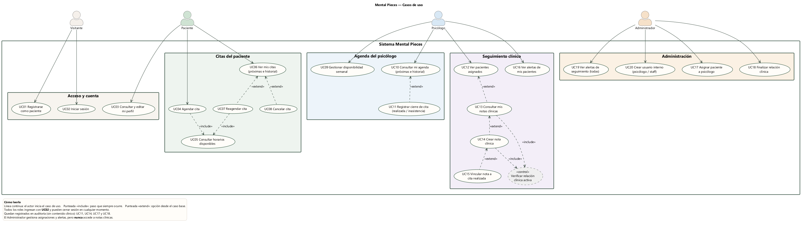

# Mental Pieces — Casos de uso

Fuente: [`use-cases.puml`](use-cases.puml) (PlantUML) · Imagen: [`use-cases.png`](use-cases.png) / [`use-cases.svg`](use-cases.svg)

## Actores

| Actor | Descripción |
| --- | --- |
| Visitante | Persona sin sesión. Puede registrarse (siempre como paciente) o iniciar sesión. |
| Paciente | Gestiona su perfil y sus citas. Nunca ve notas clínicas. |
| Psicólogo | Gestiona su disponibilidad y agenda, y el seguimiento clínico de sus pacientes asignados. |
| Administrador | Gestiona asignaciones clínicas, usuarios internos y alertas. Nunca ve notas clínicas. |

## Casos de uso

| ID | Caso de uso | Actor | Pantalla / endpoint | Reglas clave |
| --- | --- | --- | --- | --- |
| UC01 | Registrarse como paciente | Visitante | `/register` · `POST /users` | Siempre crea rol PATIENT; 5 registros/h por IP. |
| UC02 | Iniciar sesión | Visitante | `/login` · `POST /auth/login` | Bloqueo de 15 min tras 5 fallos; JWT de 15 min. |
| UC03 | Consultar y editar mi perfil | Paciente | `/profile` · `GET/PATCH /patients/me` | Identidad desde el JWT. |
| UC04 | Agendar cita | Paciente | `/appointments/new` · `POST /appointments/me` | Solo horas futuras en hora de Bogotá; máx. 4 citas futuras. |
| UC05 | Consultar horarios disponibles | (incluido) | `GET /appointments/available-slots` | Slots de 60 min dentro de la disponibilidad, sin choques. |
| UC06 | Ver mis citas (próximas e historial) | Paciente | `/appointments` · `GET /appointments/me` | Una cita programada ya pasada aparece como "Pendiente de cierre". |
| UC07 | Reagendar cita | Paciente (extiende UC06) | `PATCH /appointments/me/:id/reschedule` | Solo citas programadas que no han comenzado. |
| UC08 | Cancelar cita | Paciente (extiende UC06) | `PATCH /appointments/me/:id/cancel` | Solo citas programadas que no han comenzado; pide confirmación. |
| UC09 | Gestionar disponibilidad semanal | Psicólogo | `/psychologist/availability` · `/availability/me` | Bloques semanales sin solapes. |
| UC10 | Consultar mi agenda | Psicólogo | `/psychologist/appointments` · `GET /appointments/psychologist/me` | Próximas e historial. |
| UC11 | Registrar cierre de cita | Psicólogo (extiende UC10) | `PATCH …/:id/complete` · `…/:id/no-show` | Solo citas terminadas; queda en auditoría. |
| UC12 | Ver pacientes asignados | Psicólogo | `/psychologist/patients` · `GET /clinical/patients` | Solo pacientes con relación clínica activa. |
| UC13 | Consultar mis notas clínicas | Psicólogo (extiende UC12) | `GET /clinical/patients/:id/notes` | Incluye verificar relación activa; solo notas propias. |
| UC14 | Crear nota clínica | Psicólogo (extiende UC13) | `POST /clinical/patients/:id/notes` | 1–10 000 caracteres; queda en auditoría (sin contenido). |
| UC15 | Vincular nota a cita realizada | Psicólogo (extiende UC14) | campo `appointmentId` | Solo cita COMPLETED propia; una nota por cita. |
| UC16 | Ver alertas de mis pacientes | Psicólogo | `/psychologist/alerts` · `GET /clinical/alerts` | Inactividad, inasistencias, sin primera sesión. |
| UC17 | Asignar paciente a psicólogo | Administrador | `/admin/clinical-assignments` · `POST /clinical/assignments` | Pareja única; queda en auditoría. |
| UC18 | Finalizar relación clínica | Administrador | `PATCH /clinical/assignments/:id/end` | El psicólogo pierde el acceso clínico; queda en auditoría. |
| UC19 | Ver alertas de seguimiento (todas) | Administrador | `/admin/alerts` · `GET /clinical/admin/alerts` | Sin acceso a notas. |
| UC20 | Crear usuario interno | Administrador | `POST /staff` (solo API) | Roles STAFF o PSYCHOLOGIST. |
| — | Verificar relación clínica activa | (control, incluido) | `ClinicalAccessService` | Sin relación → 404 genérico. |
